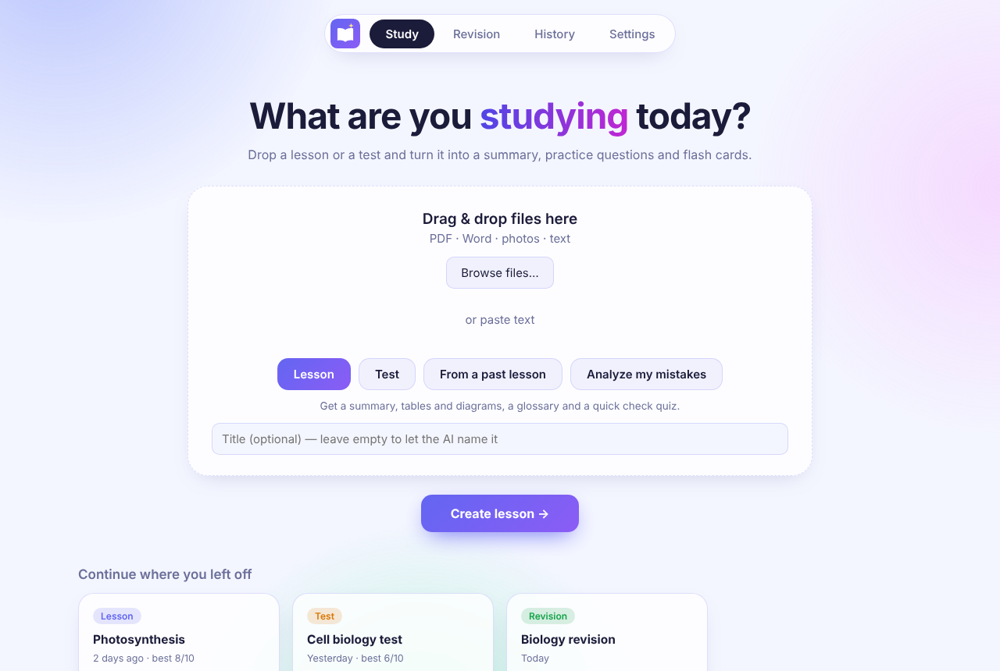
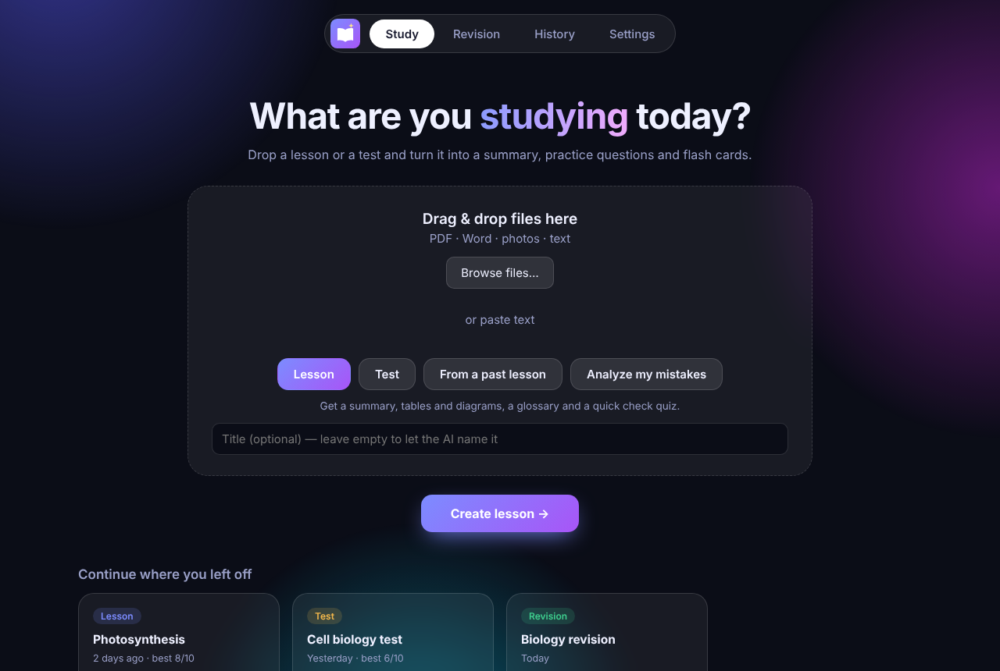
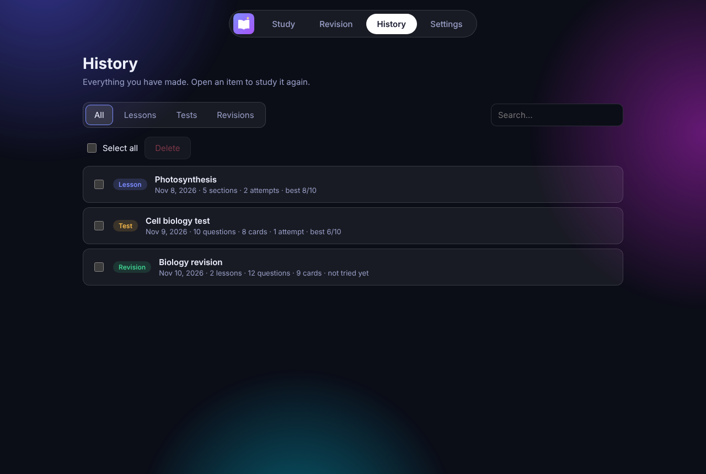

<p align="center"></p>

# StudyHelp

A desktop study assistant. Drop in a lesson or a test and it builds a summary, practice tests, flash cards and "blurry notes" for you. Everything you create is saved on your computer, so you can open it again later.

Runs locally as a desktop app (Electron): no server and no account. Your history lives in a folder on your computer.

<p align="center">
  
  
</p>

*(Screenshots use sample data.)*

## What it does

| Section | What it does |
|---|---|
| **Study** | One home screen. Drag in files (PDF, Word, photos of notes, text) or paste text, pick a mode, and go. **Lesson:** key points to tick off, a structured summary, tables and diagrams where the material suits them, a searchable glossary and a quick check quiz. **Test:** a normal test, flash cards and blurry notes. **From a past lesson:** the same test pack from a lesson you saved. **Analyze my mistakes:** upload a test you already took and get the rules you broke, your mistakes explained, and similar practice questions. |
| **Blurry notes** | Your notes with key terms hidden. You fill in one word per sentence. Only terminology is hidden, never verbs or filler words. Later repeats of a hidden word are blurred so they don't give it away. |
| **Revision** | Pick several saved lessons and/or add revision notes. You get one combined summary and a revision test (normal test, flash cards, blurry notes). |
| **History** | Every lesson, test and revision with search, filters, best scores, **Select all** and **Delete**. |
| **Settings** | Choose the AI, the colour theme (6 themes, remembered) and the output language. |

<p align="center"></p>

## Install

**Windows:** download the installer from the [Releases](../../releases) page and run it. Windows may show "Windows protected your PC" because the app isn't code-signed: click **More info → Run anyway**.

## Run from source

Requires [Node.js](https://nodejs.org) 20+.

```bash
npm install
npm start
```

Build an installer with `npm run dist`. Run the tests with `npm test`.

## Choosing the AI

Open **Settings**:

- **Gemini (Free):** no setup if your copy has a built-in key (see below). Modes: *Balanced, thinking* (default), *Deepest thinking* (slowest, tightest free limit) and *Fastest*. If a model is busy or its free limit runs out, the app retries and switches to a lighter Gemini model on its own. Free-tier prompts may be used by Google, so avoid private material.
- **Ollama:** runs on your computer, so it is private and works offline. Install [Ollama](https://ollama.com), run `ollama pull llama3.1`, and pick it. Photos are read with OCR.
- **Create new option:** paste any API key. StudyHelp recognises the provider from the key (Gemini, Anthropic, OpenAI, Groq, OpenRouter, Mistral, Cerebras, xAI, or any OpenAI-compatible address), checks the key, lists the models you can use, and saves it as an option you can switch to, edit or delete. If a key stops working, the app opens that option's edit page.

### Built-in key for "Gemini (Free)"

The repo is public, so the key is **not** in git. Copy `src/main/builtin-key.example.json` to `src/main/builtin-key.json` (git-ignored), put a free Gemini key from [aistudio.google.com](https://aistudio.google.com) in it, and then start or build the app. Without that file the option shows "Not included in this copy", and people can use Ollama or their own key.

A key shipped inside an app can be extracted by determined users, so use a throwaway key and share installers only with people you trust.

## Privacy

- Lessons, tests and history are stored only on your computer, in the app's data folder.
- API keys are encrypted with your operating system's keychain when it is available, and they never reach the user interface.
- With a cloud AI, your material is sent to that company to be processed. With Ollama, nothing leaves your computer.
- Scanned PDFs have no selectable text: export their pages as images first.

## Project layout

```
src/main/      Electron main process: file extraction, AI providers, prompts, storage, jobs
src/renderer/  UI (plain HTML/CSS/JS, no build step)
assets/        Logo and per-theme app icons
test/          Unit and end-to-end tests (AI mocked)
```

## Roadmap

- Mobile version, once the desktop one is solid.
- Cancel a running job; export history and lessons to PDF.
- Spaced repetition for missed flash cards, progress charts per lesson.

## License

MIT
